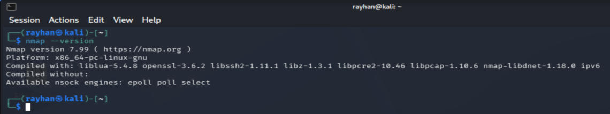
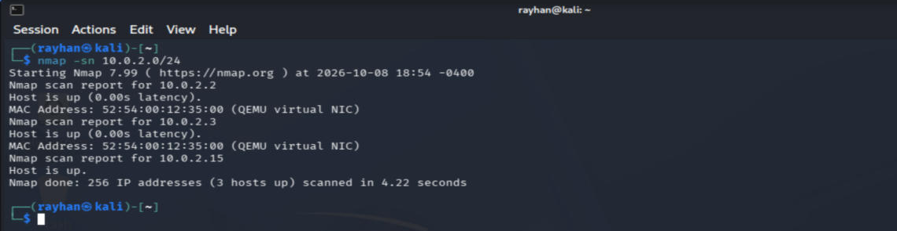
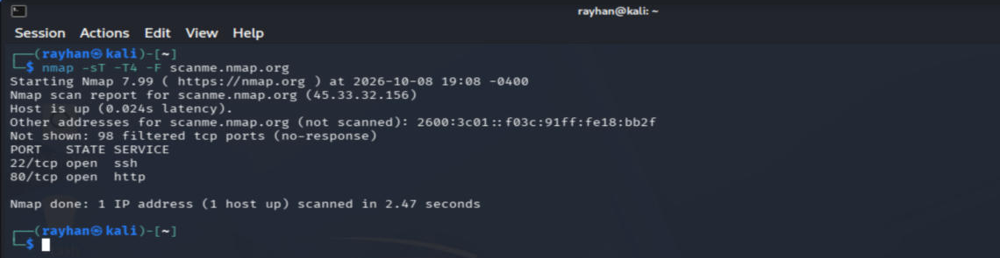
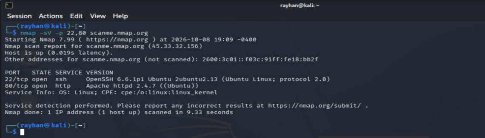
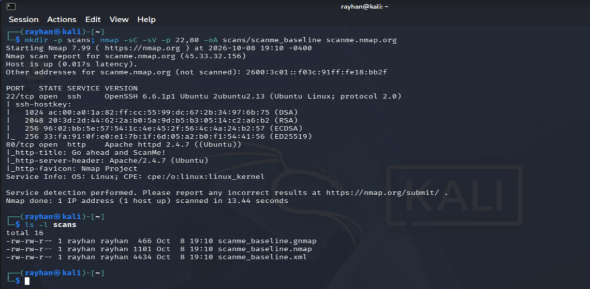
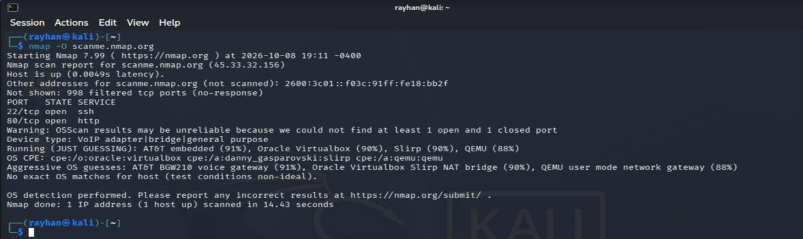

# Nmap: Hacker's Toolbox Project

**Tool:** Nmap (Network Mapper) 7.99
**Author:** Rayhan Ahmed Shium
**Course:** CYB 301, Hacker's Toolbox Project (Parts I and II)

**Video demonstration:** [Watch on YouTube](PASTE_VIDEO_LINK_HERE)

---

## Tool purpose

Nmap is a free, open-source network scanner. It finds which hosts are online, which TCP/UDP ports they have open, which software and versions run on those ports, and, with some limits, which operating system a host is running.

Security professionals use it to:

- build an inventory of devices on a network
- map the attack surface at the start of a penetration test
- confirm that a firewall change actually closed a port
- find outdated or unauthorized services

Nmap shows what is exposed. It does not rate risk or confirm that something is exploitable; tools like OpenVAS, Nikto or Burp Suite take over from there.

## Repository contents

| Folder / file | What it is |
| --- | --- |
| `README.md` | This guide |
| `docs/Hackers_Toolkit_Handbook.pdf` / `.docx` | Part I handbook: 12-tool inventory, Nmap vs OpenVAS vs Nikto comparison, Nmap user handbook |
| `screenshots/` | Real output from my lab, used in the handbook and video (Figures 1–6) |
| `examples/demo_commands.sh` | Every command from the demonstration, in order |
| `examples/scans/` | Saved scan results (`.nmap`, `.xml`, `.gnmap`) from the demonstration |

## Lab setup

| Item | Details |
| --- | --- |
| Host | Windows 11 with Oracle VirtualBox |
| Scanner | Kali Linux VM, Nmap 7.99 |
| Network | VirtualBox NAT, Kali at `10.0.2.15/24` |
| Targets | My own lab network `10.0.2.0/24`, and `scanme.nmap.org` (a host the Nmap Project provides for light practice scans) |

> **Ethics:** only scan systems you own or have written permission to test. Unauthorized scanning can break laws such as the U.S. Computer Fraud and Abuse Act.

## Installation

Download page: <https://nmap.org/download.html>

**Kali Linux:** Nmap is pre-installed.

**Debian / Ubuntu:**

```bash
sudo apt update
sudo apt install nmap -y
```

**Windows:** run the self-installer from nmap.org as administrator and keep the default components, including **Npcap** (the packet-capture driver Nmap needs) and Zenmap (the GUI).

**macOS:** run the `.dmg` installer from nmap.org, or `brew install nmap`.

**Verify the install:**

```bash
nmap --version
```



**Before the first scan:**

```bash
ip -br a                     # find your own IP and subnet (ipconfig on Windows)
mkdir -p scans               # folder for saved results
sudo nmap --script-updatedb  # update the NSE script database
```

## Basic usage

Syntax: `nmap [scan type] [options] <target>`

The demonstration follows one workflow, from broad to narrow.

### 1. Host discovery

```bash
nmap -sn 10.0.2.0/24
```

`-sn` finds live hosts without scanning ports. Result: 3 of 256 addresses up in 4.22 seconds.



### 2. Port scan

```bash
nmap -sT -T4 -F scanme.nmap.org
```

`-sT` is a TCP connect scan (no root needed), `-T4` is faster timing, `-F` scans the top 100 ports. Result: 22/tcp (ssh) and 80/tcp (http) open, 98 filtered.



### 3. Service version detection

```bash
nmap -sV -p 22,80 scanme.nmap.org
```

Result: OpenSSH 6.6.1p1 (Ubuntu) on port 22 and Apache httpd 2.4.7 (Ubuntu) on port 80. These versions can be checked against the National Vulnerability Database.



### 4. Default scripts and saving evidence

```bash
nmap -sC -sV -p 22,80 -oA scans/scanme_baseline scanme.nmap.org
ls -l scans
```

`-sC` runs the default NSE scripts (SSH host keys, web page title, server header). `-oA` saves `.nmap`, `.xml` and `.gnmap` files.



### 5. OS detection and its limits

```bash
nmap -O -T4 -F scanme.nmap.org
```

Through VirtualBox NAT, Nmap guessed "Oracle VirtualBox Slirp NAT bridge" instead of the Linux server: it fingerprinted the NAT layer. Scan from a bridged or host-only network for reliable OS guesses.



### Quick reference

| Option | What it does |
| --- | --- |
| `-sn` | Host discovery only |
| `-sT` / `-sS` / `-sU` | TCP connect / SYN (needs root) / UDP scan |
| `-F` / `-p 22,80` / `-p-` | Top 100 ports / listed ports / all 65,535 ports |
| `-sV` | Service version detection |
| `-O` | OS detection |
| `-sC` | Default NSE scripts |
| `-A` | `-sV -O -sC` plus traceroute |
| `-Pn` | Skip host discovery |
| `-T0` … `-T5` | Timing, slowest to fastest |
| `-oN` / `-oX` / `-oA` | Save as text / XML / all formats |

### Troubleshooting

| Problem | Fix |
| --- | --- |
| `requires root privileges` | Use `sudo`, or `-sT` instead of `-sS` |
| `Host seems down` | Check the address and that the host is running; retry with `-Pn` if it's in scope |
| Scan stuck at 99.99% | Press Space for progress; narrow with `-F` or `-p` and add `-T4` |
| All ports `filtered` | A firewall is dropping probes; check network and scope |
| Wrong OS guess | NAT or a firewall is in the path; trust `-sV` over `-O` |

## Strengths and limitations

**Strengths:** free and open source, runs on Windows/macOS/Linux, fast, accurate service detection, scriptable through NSE, machine-readable output.

**Limitations:** does not rate risk or suggest fixes, some scans need root, aggressive scans are noisy and trigger IDS alerts, results can be distorted by NAT and firewalls.

## References

- Lyon, G. F. (2009). *Nmap network scanning: The official Nmap project guide to network discovery and security scanning*. Insecure.Com LLC. <https://nmap.org/book/>
- Nmap Project. (n.d.-a). *Download the free Nmap security scanner*. <https://nmap.org/download.html>
- Nmap Project. (n.d.-b). *Nmap reference guide*. <https://nmap.org/book/man.html>
- Scarfone, K., Souppaya, M., Cody, A., & Orebaugh, A. (2008). *Technical guide to information security testing and assessment* (NIST SP 800-115). <https://doi.org/10.6028/NIST.SP.800-115>
- National Institute of Standards and Technology. *National Vulnerability Database*. <https://nvd.nist.gov/>
- Full reference list: see the handbook in `docs/`.
